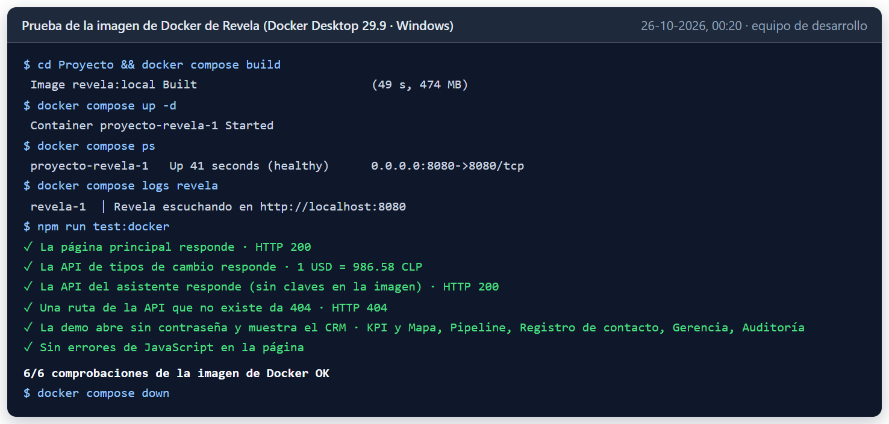
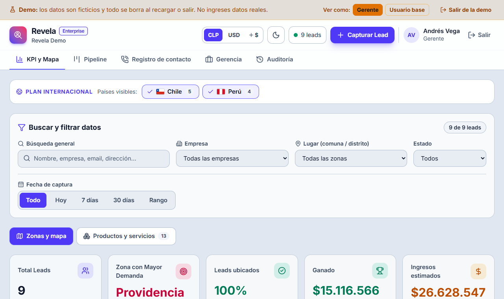

# Evidencias de sistema · Aplicación

El código de la aplicación **vive en la carpeta `Proyecto/` de este repositorio**, donde se puede instalar y ejecutar tal cual; no se
duplica aquí.

| Qué | Dónde |
|---|---|
| Interfaz (React + TypeScript) | [`src/`](../../../../Proyecto/src/) |
| API del servidor (asistente de IA, tipos de cambio, invitaciones) | [`server/`](../../../../Proyecto/server/) |
| Pruebas automáticas y scripts | [`scripts/`](../../../../Proyecto/scripts/) |
| Empaquetado: Docker | [`Dockerfile`](../../../../Proyecto/Dockerfile), [`docker-compose.yml`](../../../../Proyecto/docker-compose.yml) |
| Publicación (Vercel) | [`vercel.json`](../../../../Proyecto/vercel.json) |

**Aplicación publicada:** <https://revela-henna.vercel.app> · **demo pública, sin cuenta:** <https://revela-henna.vercel.app/?demo>

Cómo ejecutarla: [README](../../../../README.md) y [Manual técnico](../../Evidencias%20de%20documentación/Archivos%20.md/12-Manual-tecnico-y-despliegue.md).
Capturas de la aplicación en ejecución: [`docs/evidencia/`](../../../../Proyecto/docs/evidencia/).

## Prueba en Docker (26-10-2026)

La imagen se construyó y se levantó con Docker Desktop 29.9 en Windows, y se probó con `npm run test:docker`:

| Comprobación | Resultado |
|---|---|
| La imagen se construye (`docker compose build`) | ✓ en 49 s, 474 MB |
| El contenedor queda sano (`HEALTHCHECK` sobre `/api/ai/status`) | ✓ healthy |
| La página principal responde | ✓ HTTP 200 |
| La API de tipos de cambio responde | ✓ con tasas reales |
| La API del asistente responde sin claves en la imagen | ✓ HTTP 200 |
| Una ruta de la API que no existe da 404 | ✓ |
| La demo abre sin contraseña y muestra el CRM, sin errores de JavaScript | ✓ |

