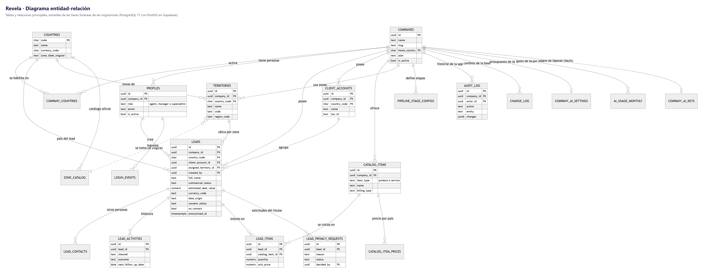

# Evidencias de sistema · Base de datos

Base **PostgreSQL 17 con PostGIS** en Supabase. El esquema completo está en **32 migraciones versionadas**, que **viven en la
carpeta `Proyecto/`** para que `npx supabase db push` las encuentre; no se duplican aquí.

| Qué | Dónde |
|---|---|
| Migraciones (esquema, RLS, triggers, funciones, zonas oficiales) | [`supabase/migrations/`](../../../../Proyecto/supabase/migrations/) |
| Glosario, orden de las tablas, reglas y procedimiento de cambios | [`docs/BASE_DE_DATOS.md`](../../../../Proyecto/docs/BASE_DE_DATOS.md) |
| Diagrama entidad-relación | [08-Modelo-de-datos.md](../../Evidencias%20de%20documentación/Archivos%20.md/08-Modelo-de-datos.md) |
| Pruebas de la base contra el proyecto real (RLS, triggers, ataques desde dentro) | [`scripts/sql/`](../../../../Proyecto/scripts/sql/) · `npm run test:db` |
| Revisión estática de las migraciones | `npm run test:sql` |
| Zonas oficiales procesadas (Chile y Perú) | [`datos/zonas/`](../../../../Proyecto/datos/zonas/) |

**Reglas que nunca se rompen:** nunca se edita una migración aplicada; toda tabla de datos lleva `company_id`, RLS, índice,
`COMMENT ON` y un trigger que valida que sus referencias son del mismo CRM; el lead se ubica por zona, nunca por coordenada.

La clave de OpenAI de cada empresa se guarda **cifrada en Supabase Vault** (migración 0032); ninguna tabla la tiene en claro.

## Diagramas y capturas

| Archivo | Qué muestra |
|---|---|
| [`Diagrama_entidad_relacion.png`](Diagrama_entidad_relacion.png) | Tablas y relaciones principales (desde las llaves foráneas de las migraciones) |
| [`Migraciones_versionadas.png`](Migraciones_versionadas.png) | Las migraciones de esta copia, en el orden en que se aplican |

