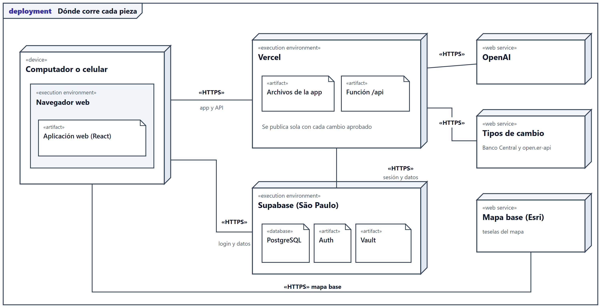

# Revela

**CRM SaaS multiempresa con inteligencia geográfica.** Captura leads, los ubica en un mapa por zona oficial (comuna,
distrito, municipio, cantón…), mide qué se vende y dónde, y opera en los 19 países de América Latina cumpliendo la Ley
21.719 de protección de datos personales.

Proyecto CAPSTONE (APT122), Ingeniería en Informática, Duoc UC, sección PTY4614-003 (003D).

- **Aplicación publicada:** <https://revela-henna.vercel.app>
- **Demo pública, sin cuenta ni contraseña** (datos ficticios que se borran al recargar): <https://revela-henna.vercel.app/?demo>

## Descripción

**Qué hace.** Cada empresa tiene su propio CRM, y los datos nunca se mezclan entre empresas.

- **KPI y mapa:** leads ubicados por su zona oficial (14.489 zonas de 19 países), zonas coloreadas por dinero ganado o por
  cierres, y ranking de zonas y de productos. El mapa muestra zonas, nunca la ubicación exacta de un lead.
- **Pipeline:** tablero por etapas, del lead nuevo hasta ganado o descartado.
- **Registro de contacto y agenda:** bitácora de cada interacción y calendario de seguimientos.
- **Gerencia:** empresas cliente, contactos, catálogo de productos y servicios (con precios por país), usuarios, países y divisas.
- **Auditoría:** historial de cambios que solo se agrega, con reversión.
- **Derechos del titular:** solicitudes de acceso, rectificación, supresión y oposición, con el lead bloqueado mientras se resuelven.
- **Administración de la plataforma:** crear y suspender empresas, exportar sus datos y ver el uso solo como números.
- **Asistente de IA:** busca empresas y registra leads con lenguaje natural, sin poder borrar nada; con presupuesto mensual y la clave de OpenAI de cada empresa.

**A quién va dirigido.** A equipos comerciales de empresas B2B que venden en uno o varios países de América Latina: vendedores,
gerentes comerciales y quienes operan la plataforma.

**Qué problema resuelve.** Las empresas no saben *dónde* cierran sus negocios ni qué productos rinden en cada zona, y llevar los
datos personales de sus leads en planillas es incompatible con la Ley 21.719 (vigente desde el 01-12-2026). Ver
[el acta de inicio](Fase%202/Evidencias%20Proyecto/Evidencias%20de%20documentación/Entrega%2006-10-2026/00_Acta_de_Inicio_del_Proyecto.docx).

## Tecnologías

| Capa | Herramientas |
|---|---|
| Lenguajes | TypeScript, SQL (PostgreSQL / PL/pgSQL), JavaScript (scripts), HTML y CSS |
| Interfaz | React 19, Vite, Tailwind CSS v4, Leaflet (mapa), Lucide (íconos) |
| Servidor (API) | Node.js 22, función serverless de Vercel; el mismo manejador corre en Vite (desarrollo) y en Docker |
| Base de datos | PostgreSQL 17 + PostGIS en Supabase: RLS, triggers, funciones, tareas programadas y Vault (secretos cifrados) |
| Autenticación | Supabase Auth |
| Cloud y despliegue | Vercel (publicación continua desde GitHub), Supabase (São Paulo), Docker y Docker Compose |
| Servicios externos | OpenAI GPT (asistente de IA), Google Places (opcional), Banco Central de Chile y open.er-api (tipos de cambio), mapas base de Esri, límites oficiales de BCN (Chile), INEI (Perú) y geoBoundaries |
| Pruebas | Scripts de Node con `--experimental-strip-types`, Puppeteer y Chrome, parser de PostgreSQL (`libpg-query`), Supabase CLI |

## Cómo ejecutarlo localmente

El código está en la carpeta [`Proyecto/`](Proyecto/); todos los comandos se ejecutan dentro de ella.

### Con Node (desarrollo)

```bash
cd Proyecto
npm ci
npm run dev
```

Abre <http://localhost:5173/?demo>. Sin configurar nada arranca la **demo**: datos ficticios en memoria, sin base de datos
ni claves. Requiere Node.js 22.

### Con Docker

```bash
cd Proyecto
docker compose up --build
```

Abre <http://localhost:8080/?demo>. Probado el 26-10-2026: la imagen se construye en menos de un minuto y `npm run test:docker`
comprueba la app, la demo y la API ([evidencia](Fase%202/Evidencias%20Proyecto/Evidencias%20de%20sistema/Aplicaci%C3%B3n/LEEME.md)).
Para conectar una base de Supabase propia, copia `Proyecto/.env.example` como `Proyecto/.env` y completa los
valores. Detalle, variables de entorno, publicación en Vercel y procedimiento de la base de datos en el
[Manual técnico](Fase%202/Evidencias%20Proyecto/Evidencias%20de%20documentación/Archivos%20.md/12-Manual-tecnico-y-despliegue.md).

### Pruebas

```bash
cd Proyecto
npx tsc -b && npm run lint
npm run test:tenant && npm run test:export && npm run test:ai && npm run test:supabase && npm run test:sql
npm run build && npm run test:bundle && npm run test:vercel
npm run dev            # en otra terminal
npm run test:e2e
npm run test:rendimiento
npm run test:docker    # con el contenedor levantado (docker compose up -d)
```

En esta copia de muestra son 727 comprobaciones automáticas más 6 mediciones de rendimiento (el repositorio de producción, más reciente, tiene 848 en 10 suites); `npm run test:db` además prueba la base real de Supabase
(requiere acceso al proyecto). Ver el [Plan de pruebas](Fase%202/Evidencias%20Proyecto/Evidencias%20de%20documentación/Archivos%20.md/11-Plan-de-pruebas.md).

## Integrantes y roles

| Integrante | Rol |
|---|---|
| **Yair Hamir Costa Pérez** | Único integrante del equipo: Product Owner, desarrollo full-stack, base de datos, seguridad, pruebas y documentación |

Ingresó a la sección cuando los equipos ya estaban conformados, por lo que desarrolla el proyecto de forma individual. El
proyecto se pilotea con una empresa de servicios de Chile y Perú, que participa como usuaria (no es integrante del equipo).

## Metodología de trabajo

**Ágil, en su variante Kanban/Scrumban, adaptada a un equipo de una persona:** iteraciones cortas (1 a 3 días) que terminan con algo
publicado, Product Backlog priorizado con historias de usuario, Definition of Done verificable, retrospectiva al cerrar cada
iteración y pruebas automáticas en cada una. Cada `push` a la rama principal publica la aplicación. Justificación y
artefactos en [el documento de metodología](Fase%202/Evidencias%20Proyecto/Evidencias%20de%20documentación/Entrega%2006-10-2026/01_Metodologia_Declarada_y_Justificada.docx).

**Tablero Scrumban (GitHub Projects, público):** <https://github.com/users/YairCosta/projects/1>, con tres estados (Pendiente, En curso, Hecho) y vinculado a este repositorio.

## Arquitectura de la solución

Una aplicación React (archivos estáticos en Vercel) que habla **directo con Supabase** con la sesión de cada persona —la
seguridad la imponen RLS y triggers en la base— y con una **única función `/api`** para lo que no puede hacer el navegador:
verificar sesiones, invitar usuarios, hacer de proxy del asistente de IA (con la clave de OpenAI de cada empresa, cifrada en
Vault) y consultar tipos de cambio. La clave secreta de Supabase vive solo en ese servidor.



Componentes, comunicación entre servicios y decisiones de arquitectura en
[07-Arquitectura.md](Fase%202/Evidencias%20Proyecto/Evidencias%20de%20documentación/Archivos%20.md/07-Arquitectura.md).

### Arquitectura 4+1 (Kruchten), en notación UML

Las cinco vistas, con su explicación, están en [07_Arquitectura_4mas1.docx](Fase%202/Evidencias%20Proyecto/Evidencias%20de%20documentación/Entrega%2013-10-2026/07_Arquitectura_4mas1.docx). Cada diagrama usa UML 2 y se genera desde el repositorio con `npm run diagramas:uml`:

| Vista | Diagrama UML | Imagen |
|---|---|---|
| Lógica: qué datos maneja y cómo se relacionan | Clases | [uml-1-clases.png](Proyecto/docs/diagramas/uml-1-clases.png) |
| De procesos: qué ocurre en ejecución | Secuencia | [uml-2-secuencia.png](Proyecto/docs/diagramas/uml-2-secuencia.png) |
| De procesos: ciclo de vida del lead | Estados | [uml-6-estados.png](Proyecto/docs/diagramas/uml-6-estados.png) |
| De desarrollo: cómo está organizado el código | Componentes | [uml-3-componentes.png](Proyecto/docs/diagramas/uml-3-componentes.png) |
| Física: dónde corre cada pieza | Despliegue | [uml-4-despliegue.png](Proyecto/docs/diagramas/uml-4-despliegue.png) |
| Escenarios (+1): quién usa Revela y para qué | Casos de uso | [uml-5-casos-de-uso.png](Proyecto/docs/diagramas/uml-5-casos-de-uso.png) |

## Estructura del repositorio

```text
.
├─ Fase 1/     Definición del proyecto: individuales (1.1 a 1.3) y grupales (presentación, 1.4, guía 1.5 y planilla)
├─ Fase 2/     Desarrollo del proyecto: individuales (2.1 y 2.2), grupales (guía 2.4 y planillas) y Evidencias Proyecto
│              (presentación, documentación, y evidencias de sistema: aplicación y base de datos)
├─ Fase 3/     Presentación final del proyecto (se completa al cierre del semestre)
└─ Proyecto/   Código de la aplicación (copia de muestra)
   ├─ src/                  Interfaz (React + TypeScript) y lógica de negocio pura (src/lib)
   ├─ server/               API: asistente de IA, tipos de cambio, invitaciones (Vercel y Docker)
   ├─ supabase/migrations/  Esquema de la base de datos (32 migraciones en esta copia; 34 en producción)
   ├─ scripts/              Pruebas automáticas y generadores de evidencia
   ├─ datos/zonas/          Zonas oficiales procesadas
   ├─ docs/                 Documentación técnica (base de datos, seguridad, IA, Ley 21.719, BPMN, despliegue…)
   └─ Dockerfile, docker-compose.yml, .env.example
```

El código de `Proyecto/` es una copia de muestra para la evaluación; la aplicación publicada se desarrolla en un repositorio
privado.

## Documentación

Las guías de la Fase 2 están en [`Fase 2/Evidencias Grupales`](Fase%202/Evidencias%20Grupales/) (2.4) y [`Fase 2/Evidencias Individuales`](Fase%202/Evidencias%20Individuales/) (diario 2.1 y autoevaluación 2.2). Las capturas de la aplicación, la prueba en Docker y el diagrama entidad-relación, en [`Fase 2/Evidencias Proyecto/Evidencias de sistema`](Fase%202/Evidencias%20Proyecto/Evidencias%20de%20sistema/).

En [`Fase 2/Evidencias Proyecto/Evidencias de documentación`](Fase%202/Evidencias%20Proyecto/Evidencias%20de%20documentación/):

- [`Entrega 06-10-2026`](Fase%202/Evidencias%20Proyecto/Evidencias%20de%20documentación/Entrega%2006-10-2026/): acta de inicio, metodología, Product Vision, Product Backlog, Sprint Backlog, Definition of Done y retrospectivas.
- [`Entrega 13-10-2026`](Fase%202/Evidencias%20Proyecto/Evidencias%20de%20documentación/Entrega%2013-10-2026/): arquitectura 4+1 con diagramas UML.
- [`Arquitectura 4+1 (UML)`](Fase%202/Evidencias%20Proyecto/Evidencias%20de%20documentación/Arquitectura%204%2B1%20%28UML%29/) y [`Diagramas BPMN`](Fase%202/Evidencias%20Proyecto/Evidencias%20de%20documentación/Diagramas%20BPMN/): los diagramas como imágenes.
- Presentaciones: [Fase 1](Fase%201/Evidencias%20Grupales/Presentación%20Proyecto.pptx) (definición, avance y roadmap) y [Fase 2](Fase%202/Evidencias%20Proyecto/Presentación%20Proyecto.pptx) (arquitectura 4+1 con UML y evidencias). La guía de definición del proyecto (1.5) está en [`Fase 1/Evidencias Grupales`](Fase%201/Evidencias%20Grupales/).
- [`Archivos .md`](Fase%202/Evidencias%20Proyecto/Evidencias%20de%20documentación/Archivos%20.md/): arquitectura, modelo de datos, UML, requisitos no funcionales, plan de pruebas, manual técnico e innovación.
- Documentación técnica de fondo: [`Proyecto/docs/`](Proyecto/docs/) (base de datos, seguridad, asistente de IA, Ley 21.719, procesos BPMN, despliegue).

## Estado

Publicada en Vercel y conectada a Supabase, en piloto con una empresa real. Pasó una revisión de seguridad por casos de uso el
27-09-2026 ([`Proyecto/docs/SEGURIDAD.md`](Proyecto/docs/SEGURIDAD.md) §5). La demo pública se abre sin contraseña con `?demo`.

> Este repositorio es la copia de evaluación del proyecto: incluye el historial de desarrollo, con los datos de la empresa
> piloto reemplazados por datos de demostración.
